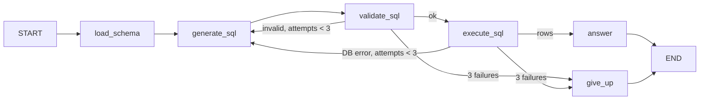

# 03 · SQL Assistant

Ask questions about customers, products and orders in plain English. The assistant writes PostgreSQL, checks it, runs it read-only, **fixes its own mistakes** and explains the result.

## Graph



| Node | What it does |
|------|--------------|
| `load_schema` | Reads table/column names from `information_schema` (only tables the reader role can see) |
| `generate_sql` | LLM writes one SELECT; on retry it sees its previous SQL and the exact error |
| `validate_sql` | Python checks: SELECT/WITH only, single statement, no DDL/DML keywords |
| `execute_sql` | Calls the `run_readonly_sql` RPC |
| `answer` | LLM summarises the rows in 1-3 sentences |

### Layered safety

1. **Python validator** rejects anything that is not a single SELECT.
2. **Database function** `run_readonly_sql` re-checks the statement, wraps it in a subquery (which blocks data-modifying CTEs) and caps results at 200 rows.
3. **Database role** `sql_assistant_reader`: the query runs as a role that has `SELECT` on `customers`, `products` and `orders` only. Even a perfect injection can't write or read other tables.

## Run

```bash
cd 03_sql_assistant
python main.py                                     # interactive
python main.py "Who are the top 3 customers by total spend?"
```

## Try these

```
How many customers do we have in each city?
Top 3 customers by total spend
What is the revenue per product category?
Which orders are still not delivered?
List premium customers who ordered audio products
What was the average order value in September 2026?
Delete all orders                         -> refused
```

## API

```bash
uvicorn api:app --port 8003      # docs: http://127.0.0.1:8003/docs
```

| Method | Path | Body | Returns |
|--------|------|------|---------|
| POST | `/query` | `{"question": "Top 3 customers by total spend"}` | `answer`, `sql`, `attempts`, `succeeded`, `row_count`, `rows` |
| GET | `/schema` | | Tables and columns the assistant can query |
| GET | `/health` | | `{"status": "ok"}` |

## What to learn from it

- Conditional edges that **loop back** with error feedback: the core of self-correcting agents.
- A bounded retry counter in state to prevent infinite loops.
- Defence in depth: never trust only the prompt or only the validator.
