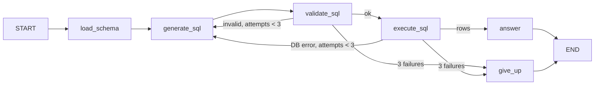

# 03 · SQL Assistant

Ask questions about customers, products and orders in plain English. The assistant writes PostgreSQL, checks it, runs it read-only, **fixes its own mistakes** and explains the result.

## Database setup (Supabase)

1. Open your project in the [Supabase Dashboard](https://supabase.com/dashboard) → **SQL Editor** → **New query**.
2. Paste the SQL from each step below, in order, and click **Run**. "Success. No rows returned" means it worked.
3. Run the verify query at the end.

All statements are idempotent (`if not exists`, `on conflict do nothing`), so running them twice never duplicates data. The same SQL is part of [`supabase/schema.sql`](../supabase/schema.sql), which sets up **all six modules at once**; if you have already run that, skip this section.

**Step 1: shared tables** (`customers`, `products`, `orders`). Skip if you already created them for another module; re-running is harmless.

<details>
<summary>Show SQL: shared tables + sample data</summary>

```sql
create table if not exists customers (
    id bigint generated by default as identity primary key,
    name text not null,
    city text not null,
    email text
);
alter table customers add column if not exists plan text not null default 'basic';
alter table customers add column if not exists created_at timestamptz not null default now();
create unique index if not exists customers_email_key on customers (email);

insert into customers (name, city, email, plan) values
    ('Rahul',  'Delhi',     'rahul@example.com',  'premium'),
    ('Priya',  'Mumbai',    'priya@example.com',  'basic'),
    ('Amit',   'Pune',      'amit@example.com',   'basic'),
    ('Sneha',  'Bengaluru', 'sneha@example.com',  'premium'),
    ('Vikram', 'Chennai',   'vikram@example.com', 'enterprise'),
    ('Ananya', 'Hyderabad', 'ananya@example.com', 'basic'),
    ('Karan',  'Delhi',     'karan@example.com',  'premium'),
    ('Meera',  'Kolkata',   'meera@example.com',  'basic')
on conflict (email) do update set plan = excluded.plan;

create table if not exists products (
    id bigint generated by default as identity primary key,
    sku text not null unique,
    name text not null,
    category text not null,
    price numeric(10, 2) not null
);

insert into products (sku, name, category, price) values
    ('SW-X1',    'SmartWatch X1',               'Wearables',   4999),
    ('EB-PRO',   'Wireless Earbuds Pro',        'Audio',       2999),
    ('SPK-MINI', 'Bluetooth Speaker Mini',      'Audio',       1999),
    ('LS-STD',   'Laptop Stand',                'Accessories', 1499),
    ('HUB-7',    'USB-C Hub 7-in-1',            'Accessories', 2499),
    ('NC-HP',    'Noise Cancelling Headphones', 'Audio',       8999),
    ('FB-LITE',  'Fitness Band Lite',           'Wearables',   1799),
    ('KB-MECH',  'Mechanical Keyboard',         'Accessories', 3999)
on conflict (sku) do nothing;

create table if not exists orders (
    id bigint generated by default as identity primary key,
    order_number text not null unique,
    customer_id bigint not null references customers (id),
    product_id bigint not null references products (id),
    quantity int not null check (quantity > 0),
    total numeric(10, 2) not null,
    status text not null check (status in ('placed', 'shipped', 'delivered', 'cancelled', 'returned')),
    order_date date not null
);

-- Orders are inserted by email / SKU so the ids resolve correctly in any database.
insert into orders (order_number, customer_id, product_id, quantity, total, status, order_date)
select v.order_number, c.id, p.id, v.qty, p.price * v.qty, v.status, v.order_date::date
from (values
    ('ORD-1001', 'rahul@example.com',  'SW-X1',    1, 'delivered', '2026-08-02'),
    ('ORD-1002', 'priya@example.com',  'EB-PRO',   1, 'delivered', '2026-09-28'),
    ('ORD-1003', 'amit@example.com',   'HUB-7',    2, 'delivered', '2026-08-15'),
    ('ORD-1004', 'sneha@example.com',  'NC-HP',    1, 'delivered', '2026-09-05'),
    ('ORD-1005', 'amit@example.com',   'KB-MECH',  1, 'delivered', '2026-10-01'),
    ('ORD-1006', 'vikram@example.com', 'LS-STD',   5, 'delivered', '2026-08-20'),
    ('ORD-1007', 'ananya@example.com', 'FB-LITE',  1, 'cancelled', '2026-09-12'),
    ('ORD-1008', 'karan@example.com',  'SPK-MINI', 2, 'delivered', '2026-09-18'),
    ('ORD-1009', 'rahul@example.com',  'NC-HP',    1, 'shipped',   '2026-10-14'),
    ('ORD-1010', 'meera@example.com',  'EB-PRO',   1, 'delivered', '2026-08-25'),
    ('ORD-1011', 'vikram@example.com', 'SW-X1',    3, 'placed',    '2026-10-18'),
    ('ORD-1012', 'meera@example.com',  'NC-HP',    1, 'delivered', '2026-10-06'),
    ('ORD-1013', 'sneha@example.com',  'FB-LITE',  2, 'returned',  '2026-08-10'),
    ('ORD-1014', 'karan@example.com',  'KB-MECH',  1, 'shipped',   '2026-10-16'),
    ('ORD-1015', 'priya@example.com',  'SPK-MINI', 1, 'placed',    '2026-10-19')
) as v (order_number, email, sku, qty, status, order_date)
join customers c on c.email = v.email
join products p on p.sku = v.sku
on conflict (order_number) do nothing;

alter table customers enable row level security;
alter table products  enable row level security;
alter table orders    enable row level security;
```

</details>

**Step 2: read-only role and SQL function**: creates the `sql_assistant_reader` role (SELECT on three tables only), the guarded `run_readonly_sql()` function and the read policies it needs because RLS is on.

```sql
do $$
begin
    if not exists (select 1 from pg_roles where rolname = 'sql_assistant_reader') then
        create role sql_assistant_reader nologin;
    end if;
end $$;

grant usage on schema public to sql_assistant_reader;
grant select on customers, products, orders to sql_assistant_reader;
grant sql_assistant_reader to service_role;

create or replace function run_readonly_sql(query text)
returns jsonb
language plpgsql
security invoker
set search_path = public
as $$
declare
    cleaned text := rtrim(query, E'; \n\t');
    result jsonb;
begin
    if cleaned !~* '^\s*(select|with)\s' then
        raise exception 'Only SELECT queries are allowed';
    end if;
    if position(';' in cleaned) > 0 then
        raise exception 'Only a single statement is allowed';
    end if;
    set local role sql_assistant_reader;
    execute format(
        'select coalesce(jsonb_agg(t), ''[]''::jsonb) from (select * from (%s) q limit 200) t',
        cleaned
    ) into result;
    return result;
end;
$$;

revoke execute on function run_readonly_sql(text) from public, anon, authenticated;
grant execute on function run_readonly_sql(text) to service_role;

-- RLS is on for these tables, so the reader role needs explicit read policies.
drop policy if exists sql_reader_select on customers;
drop policy if exists sql_reader_select on products;
drop policy if exists sql_reader_select on orders;
create policy sql_reader_select on customers for select to sql_assistant_reader using (true);
create policy sql_reader_select on products  for select to sql_assistant_reader using (true);
create policy sql_reader_select on orders    for select to sql_assistant_reader using (true);
```

**Verify:** the function should answer, and refuse anything that isn't a SELECT:

```sql
select run_readonly_sql('select count(*) as orders from orders');   -- [{"orders": 15}]
select run_readonly_sql('delete from orders');                       -- ERROR: Only SELECT queries are allowed
```

<!-- supabase-snapshot:start -->

### See it in Supabase

After running the SQL above:

1. **Create:** left sidebar → **SQL Editor** (`>_` icon) → **New query** → paste the SQL → **Run** (or Ctrl+Enter).
2. **Check:** left sidebar → **Database** → **Tables**, schema **public**. You should see this module's tables: `customers`, `products`, `orders`.
3. **Browse data:** click a table (or open **Table Editor**, the grid icon) to see its rows; **View columns** lists the column types.

> The dashboard shows rows because you are logged in as the project owner. Row Level Security still blocks the public (anon) key.


<sub>Tables `chat_messages` … `fin_accounts`</sub>


<sub>Tables `hr_policies` … `ticket_events` (19 tables in total; `students` is unrelated to this repo)</sub>

### Table snapshot

Generated from the live database with `python supabase/snapshot_readmes.py`.

#### `customers` · 8 rows

| Column | Type | Notes |
|--------|------|-------|
| `id` | bigint | PK, auto id |
| `name` | text | required |
| `city` | text | required |
| `email` | text | unique |
| `plan` | text | default `'basic'::text`, required |
| `created_at` | timestamp with time zone | default `now()`, required |

Sample rows:

| id | name | city | email | plan |
|---|---|---|---|---|
| 1 | Rahul | Delhi | rahul@example.com | premium |
| 2 | Priya | Mumbai | priya@example.com | basic |
| 5 | Amit | Pune | amit@example.com | basic |

#### `products` · 8 rows

| Column | Type | Notes |
|--------|------|-------|
| `id` | bigint | PK, auto id |
| `sku` | text | unique, required |
| `name` | text | required |
| `category` | text | required |
| `price` | numeric(10,2) | required |

Sample rows:

| sku | name | category | price |
|---|---|---|---|
| EB-PRO | Wireless Earbuds Pro | Audio | 2999.00 |
| FB-LITE | Fitness Band Lite | Wearables | 1799.00 |
| HUB-7 | USB-C Hub 7-in-1 | Accessories | 2499.00 |

#### `orders` · 15 rows

| Column | Type | Notes |
|--------|------|-------|
| `id` | bigint | PK, auto id |
| `order_number` | text | unique, required |
| `customer_id` | bigint | FK → `customers`, required |
| `product_id` | bigint | FK → `products`, required |
| `quantity` | integer | required |
| `total` | numeric(10,2) | required |
| `status` | text | required |
| `order_date` | date | required |

Sample rows:

| order_number | customer_id | product_id | quantity | total | status | order_date |
|---|---|---|---|---|---|---|
| ORD-1001 | 1 | 1 | 1 | 4999.00 | delivered | 2026-08-02 |
| ORD-1002 | 2 | 2 | 1 | 2999.00 | delivered | 2026-09-28 |
| ORD-1003 | 5 | 5 | 2 | 4998.00 | delivered | 2026-08-15 |

<!-- supabase-snapshot:end -->

## Graph



| Node | What it does |
|------|--------------|
| `load_schema` | Reads table/column names from `information_schema` (only tables the reader role can see) |
| `generate_sql` | LLM writes one SELECT; on retry it sees its previous SQL and the exact error |
| `validate_sql` | Python checks: SELECT/WITH only, single statement, no DDL/DML keywords |
| `execute_sql` | Calls the `run_readonly_sql` RPC |
| `answer` | LLM summarises the rows in 1-3 sentences |

### Layered safety

1. **Python validator** rejects anything that is not a single SELECT.
2. **Database function** `run_readonly_sql` re-checks the statement, wraps it in a subquery (which blocks data-modifying CTEs) and caps results at 200 rows.
3. **Database role** `sql_assistant_reader`: the query runs as a role that has `SELECT` on `customers`, `products` and `orders` only. Even a perfect injection can't write or read other tables.

## Run

```bash
cd 03_sql_assistant
python main.py                                     # interactive
python main.py "Who are the top 3 customers by total spend?"
```

## Try these

```
How many customers do we have in each city?
Top 3 customers by total spend
What is the revenue per product category?
Which orders are still not delivered?
List premium customers who ordered audio products
What was the average order value in September 2026?
Delete all orders                         -> refused
```

## API

```bash
uvicorn api:app --port 8003      # docs: http://127.0.0.1:8003/docs
```

| Method | Path | Body | Returns |
|--------|------|------|---------|
| POST | `/query` | `{"question": "Top 3 customers by total spend"}` | `answer`, `sql`, `attempts`, `succeeded`, `row_count`, `rows` |
| GET | `/schema` | | Tables and columns the assistant can query |
| GET | `/health` | | `{"status": "ok"}` |

## What to learn from it

- Conditional edges that **loop back** with error feedback: the core of self-correcting agents.
- A bounded retry counter in state to prevent infinite loops.
- Defence in depth: never trust only the prompt or only the validator.
